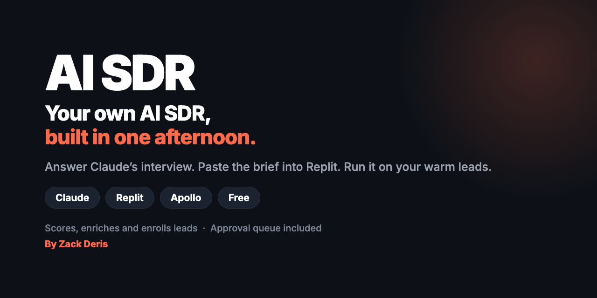
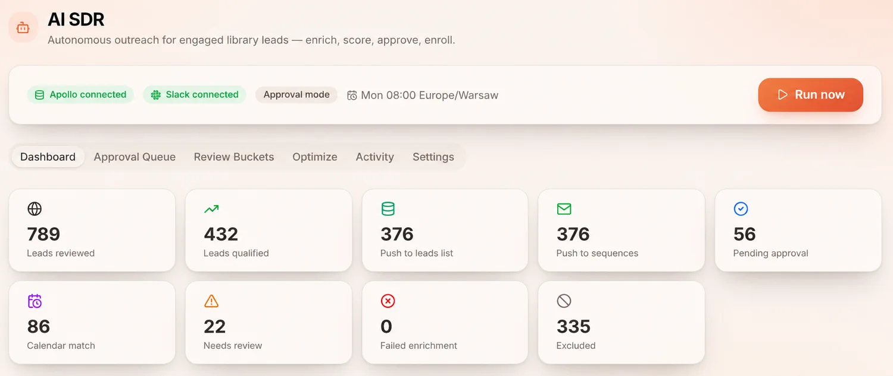
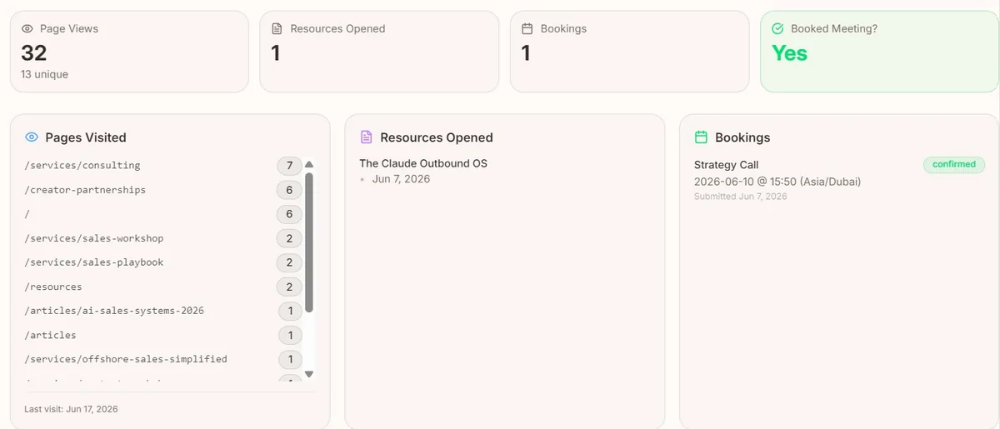
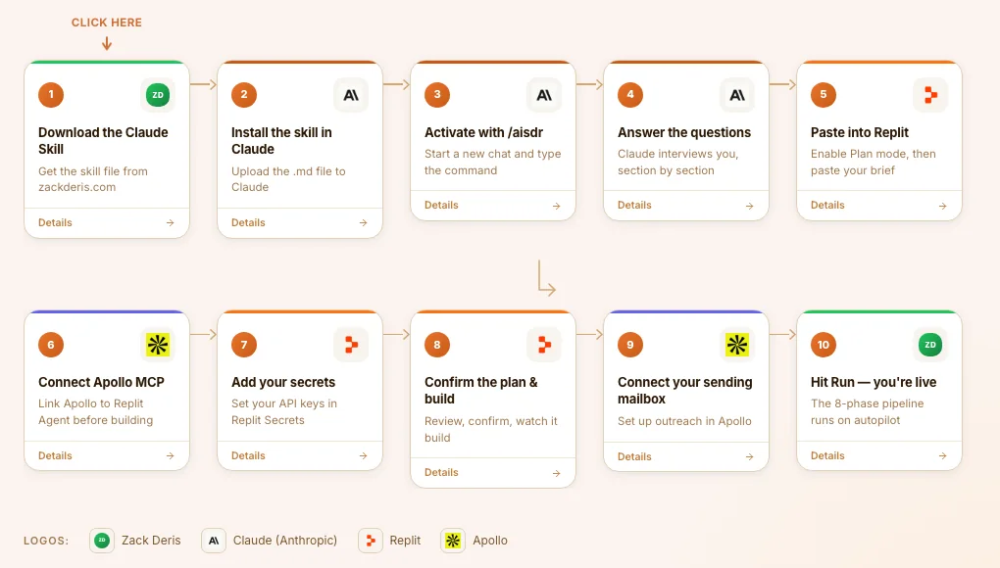
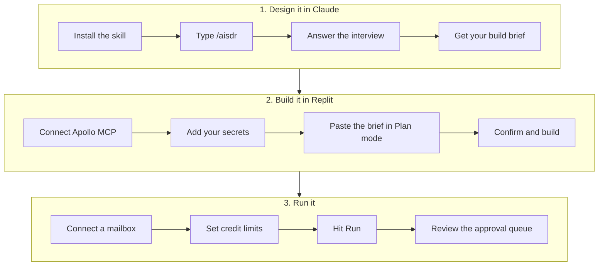
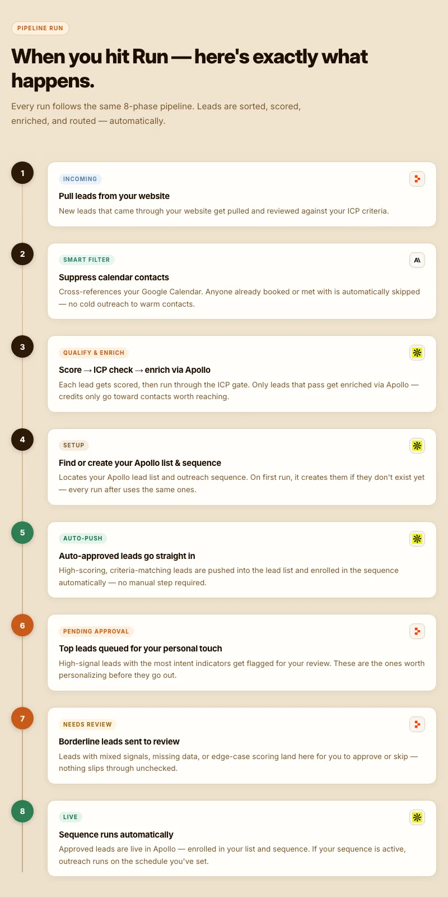

<p align="center">
  
</p>

<p align="center">
  <a href="../../releases/latest"></a>
  
  
</p>

<p align="center">
  <a href="https://zackderis.com/aisdr"><b>Full guide</b></a> ·
  <a href="https://zackderis.com/aisdr/flow"><b>Visual flow</b></a> ·
  <a href="docs/how-it-works.md"><b>How it works</b></a> ·
  <a href="../../releases/latest"><b>Download</b></a>
</p>

**AI SDR is a free Claude skill that designs an automated sales development system around your business, then hands Replit the plan to build it.** Claude interviews you about your offer, ideal customer and outreach. It writes a complete build brief. You paste that into Replit Agent and get your own system that scores warm leads, enriches the good ones through Apollo and enrolls them in a sequence.

It's built for the leads you already have: people who signed up, downloaded something or engaged with your site. You keep control through an approval queue and a dashboard you own.

You don't write the spec. You answer questions in plain English, and the skill does the rest.

## Contents

- [The system you end up with](#the-system-you-end-up-with)
- [The build path](#the-build-path)
- [What happens on every run](#what-happens-on-every-run)
- [Quick start](#quick-start)
- [What you need](#what-you-need)
- [What it does and doesn't do on its own](#what-it-does-and-doesnt-do-on-its-own)
- [FAQ](#faq)
- [What's in this repo](#whats-in-this-repo)
- [About](#about)

## The system you end up with

<p align="center">
  
</p>

This is Zack's own AI SDR, running on zackderis.com's resource library: 789 leads reviewed, 432 qualified and 376 pushed into sequences. Your numbers will depend on your leads, rules and offer.

Every system includes a password-protected `/admin` dashboard with these tabs: Dashboard, Approval Queue, Review Buckets, Optimize, Activity and Settings. You can also see what each lead did before you reach out:

<p align="center">
  
</p>

## The build path

<p align="center">
  
</p>



**[See every step with screenshots →](docs/how-it-works.md)**

## What happens on every run

<p align="center">
  
</p>

One detail on phase 3: every lead that clears the exclusions and calendar check is enriched, and the final ICP check runs after that using Apollo's data.

## Quick start

1. **[Download `aisdr.zip`](../../releases/latest).**
2. At [claude.ai](https://claude.ai), go to **Customize → Skills → Add → Upload skill**, and upload the zip.
3. Open a new chat and type `/aisdr`.
4. Answer the questions. Claude researches your website to pre-fill what it can.
5. In [Replit](https://replit.com/refer/zackderis), connect Apollo's MCP server (`https://mcp.apollo.io/mcp`) under **Settings → Integrations**.
6. Save the brief as a `.md` file, tick **Plan mode**, attach it to the prompt box and confirm the plan.

The [full guide](https://zackderis.com/aisdr) walks through every screen.

## What you need

| Need | Details |
|---|---|
| **Claude** | A plan that supports skills: Pro, Max, Team or Enterprise. |
| **[Replit](https://replit.com/refer/zackderis)** | Where the system is built and hosted. Works best if your website is already on Replit. |
| **[Apollo](https://get.apollo.io/zack)** | An API key stored as `APOLLO_API_KEY`, the Apollo MCP connected in Replit, and a mailbox connected for sending. Use a master key for full sequence and custom-field management. |
| **Apollo credits** | 1 credit per email, 8 per phone number. A fully automatic weekly run typically uses 100 to 200+ credits, so set a weekly cap if you need one. |
| **`ADMIN_PASSWORD`** | A Replit secret that protects your dashboard. Never paste it into the chat. |
| **Optional** | Google Calendar to skip people you've already met, Slack for notifications, and Resend for transactional or broadcast email. |

## What it does and doesn't do on its own

- **The first run always waits for you.** After you've reviewed that batch, you can choose full approval, partial with auto-push rules, or fully automated.
- **Permission is part of the pipeline.** Leads without a recorded opt-in wait for a person to review them, before any credits are spent.
- **Decisions follow a fixed order.** Every lead goes through the same 17 steps and gets a recorded outcome.
- **Failures stay visible.** A failed Apollo push goes to review and is never counted as sent.
- **Resets can't delete your leads.** The destructive reset needs typed confirmation and warns you first.
- **Exclusions run before enrichment.** Suppressed contacts, and anyone you've already met, don't cost credits. Enrichment happens before the final ICP check, so set a credit cap if your volume is high.
- **Warm contacts are protected.** With Calendar connected, anyone you've already met is skipped.
- **Lead data stays out of the brief.** CSVs go directly to Replit, and only column names can appear in the spec.
- **Secrets stay in Replit.** The interview never asks for your dashboard password or API keys.
- **Replit plans before it builds.** The agent shows a step-by-step plan and waits for you to confirm.

Treat the first runs as a test: use approval mode and check the copy before going automatic. You're responsible for what the system sends and how it handles personal data, including having a lawful basis to contact the people on your list.

## FAQ

<details><summary><b>Is the skill really free?</b></summary>

Yes. You pay for your Claude plan, Replit usage and any Apollo credits the system spends.
</details>

<details><summary><b>Do I need to be technical?</b></summary>

No code is required. You do need to follow setup steps carefully, such as adding API keys as Replit secrets and connecting Apollo.
</details>

<details><summary><b>How does it handle permission to email people?</b></summary>

The interview asks what your leads agreed to. Anyone without a recorded opt-in waits in your approval queue, and unsubscribes are honoured on every run. The right rules depend on where your leads are, so check them for your market.
</details>

<details><summary><b>Does an AI decide who gets contacted?</b></summary>

No. Each run follows the scoring and routing rules you set, so decisions are predictable and you can audit them. Claude and Replit Agent design and build the system, and Apollo sends the sequence.
</details>

<details><summary><b>What if my website isn't on Replit?</b></summary>

It can still run. Export your contacts as a CSV and upload it to Replit, and the agent maps the fields. Scoring has less to work with, because it relies on email validity, LinkedIn presence and ICP fit instead of site behaviour.
</details>

<details><summary><b>What if I don't have any leads yet?</b></summary>

Choose "No leads yet" in the interview and the agent builds lead capture from scratch.
</details>

<details><summary><b>Can it review every email before it goes out?</b></summary>

Yes. Choose full approval in the interview, and leads wait in the Approval Queue.
</details>

<details><summary><b>Is this the same as OutboundOS or GTMAI?</b></summary>

No. AI SDR is software you own, built for warm leads and running on a schedule. [OutboundOS](https://github.com/Zackderis/outboundos) and [GTMAI](https://github.com/Zackderis/gtmai) run cold outbound inside an AI chat.
</details>

<details><summary><b>Can I use it for my clients?</b></summary>

Yes. You can use and edit it for your own business and for clients you serve. You can't resell or redistribute it. See the [license](LICENSE).
</details>

<details><summary><b>I found a bug. Where do I report it?</b></summary>

[Open an issue](../../issues) with the interview section or build step you were on. Please leave out any API keys or lead data.
</details>

## What's in this repo

```
aisdr/
  SKILL.md             The interview and the build-brief template
  references/          The system rules written into every brief
docs/                  Step-by-step guide and images
CHANGELOG.md           What's new
LICENSE                What you can and can't do with it
```

To package your own edited copy, run:

```bash
mkdir -p dist && zip -r dist/aisdr.zip aisdr
```

## About

Built by **[Zack Deris](https://zackderis.com)**, AI Sales Systems Consultant. In sales since 2009, now building AI-powered outbound systems for B2B founders and teams.

**Want it built for you?** [Book a call](https://zackderis.com/book-a-call).

[LinkedIn](https://www.linkedin.com/in/zdnft) · [YouTube](https://www.youtube.com/@zackderis) · [X](https://x.com/zackydzz)

More free skills: [GTMAI](https://github.com/Zackderis/gtmai) · [OutboundOS](https://github.com/Zackderis/outboundos) · [Gamma Prompt Library](https://github.com/Zackderis/gamma-prompt-library)

Free for your own business and your clients, not for resale or redistribution. See [LICENSE](LICENSE). The Apollo and Replit links above are partner links, so Zack may earn a commission or credit if you sign up through them, at no cost to you. AI SDR isn't affiliated with or endorsed by Anthropic, Replit or Apollo.io.
