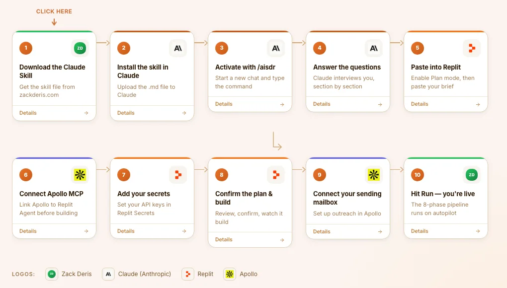
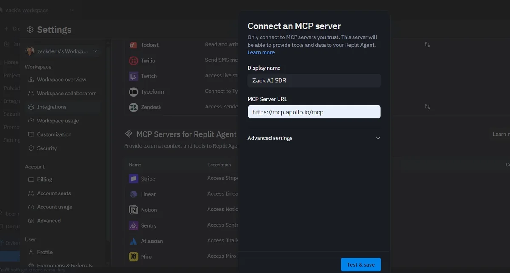
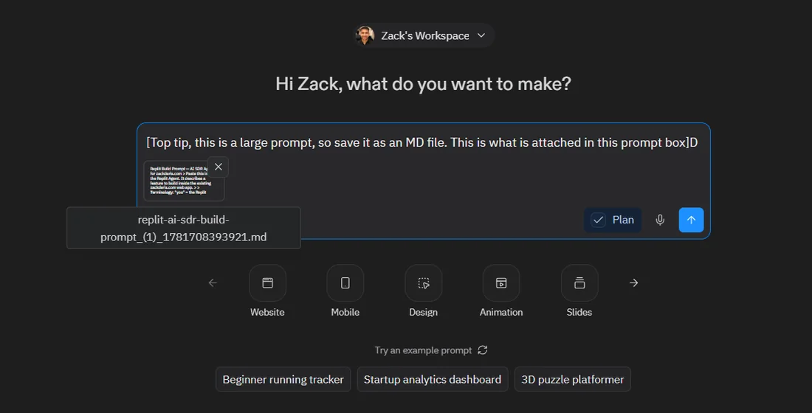
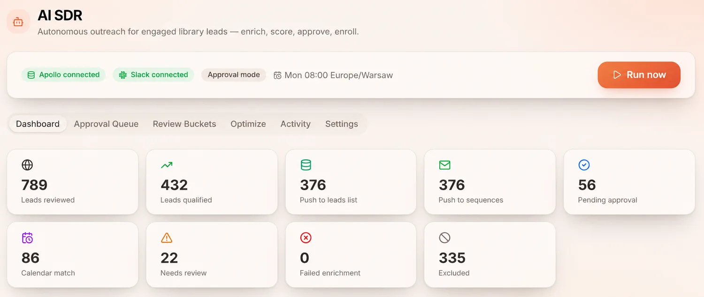
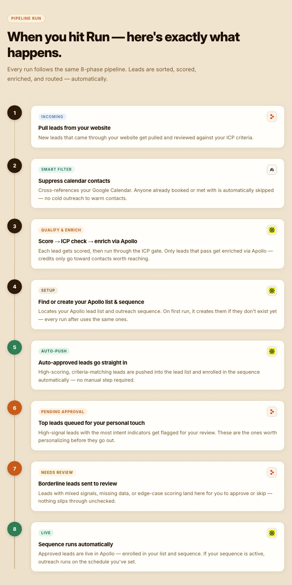

# How AI SDR works

From installing the skill to your first automated run. [Back to the README](../README.md) · [Full guide on zackderis.com](https://zackderis.com/aisdr)

## Part 1: Design it in Claude

### 1. Install the skill

Download `aisdr.zip` from the [latest release](https://github.com/Zackderis/ai-sdr/releases/latest). At claude.ai, go to **Customize → Skills → Add → Upload skill**.

### 2. Run the interview

Open a new chat and type `/aisdr`. Claude works through these sections and researches your website to pre-fill answers:

| Section | What it settles |
|---|---|
| Your website and leads | Whether leads come from your Replit database, a CSV, or new capture |
| Who you are | Business, offer and price |
| Your ICP | Industry, size, titles, geography, pain and disqualifiers |
| Scoring | Which signals make a lead hot |
| Outreach | Sender, tone, length, goal, booking link and Apollo sequence |
| Approval and schedule | Full, partial or automatic, plus notifications and run timing |
| Dashboard | Standard tabs, extras and look |
| Apollo and integrations | Account type, mailbox, Calendar, Slack and others |
| Constraints | Geo-blocking, send caps and anything else |

The result is a complete build brief for Replit Agent.

## Part 2: Build it in Replit

### 3. Connect Apollo's MCP server

In Replit, go to **Settings → Integrations → MCP Servers for Replit Agent → Add MCP Server**, and paste `https://mcp.apollo.io/mcp`.

### 4. Add your secrets

Add `APOLLO_API_KEY` in Replit Secrets. Set `ADMIN_PASSWORD` for the dashboard, or let the agent generate one on first run and save it. If you're using broadcast or transactional email, add `RESEND_API_KEY` too.

### 5. Paste the brief in Plan mode

The brief is long, so save it as a `.md` file and attach it. Tick **Plan mode**, read the plan and confirm it.

### 6. Connect your leads

- **Website on Replit:** point the agent at your leads table, which already holds names, emails, LinkedIn profiles and engagement.
- **Anywhere else:** export a CSV and upload it to the Replit chat.

### 7. Set your rules

Be explicit about what qualifies a lead, what excludes one, and who must never be contacted. Specific rules waste fewer credits.

### 8. Set your Apollo credit limits

A fully automatic weekly run typically uses 100 to 200+ credits. Set a cap if your plan needs one.

### 9. Connect your sending mailbox

Connect Gmail or Outlook in Apollo so sequence emails can send.

## Part 3: Run it

### 10. Hit Run

Every run follows the same pipeline:

Start in approval mode, review the first batch of emails, and only then consider auto-push rules.
